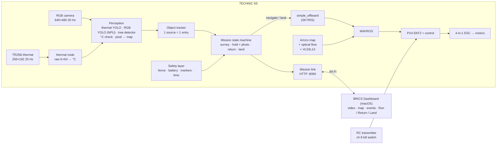

# 1. Technical description

## 1.1 Purpose

An autonomous UAV system that flies a predefined survey route in a GPS-denied area, processes thermal and RGB images on board in real time, finds ignition sources (a heat source and a simulated campfire/flame) and an additional object (trees), computes their map coordinates, and shows them live on the operator's map with type, temperature and time. Built for Case 1 *"University 2035: Autonomous Forest Fire Monitoring"* on the SKYRIS TECHNIC 6S platform.

## 1.2 Main characteristics

| Parameter | Value | How we know |
|---|---|---|
| Platform | SKYRIS TECHNIC 6S quadcopter, PX4 v1.17.0, Orange Pi 5 Pro (RK3588S, NPU) | Read from the drone |
| Positioning | GPS-denied: ArUco marker map (7.5 × 4.5 m, 45 markers) + optical flow + VL53L1X rangefinder fused in PX4 EKF2 | `Others/evidence/drone_config/px4_params.txt` |
| Cameras | RGB 640 × 480 @ 30 Hz (down); TR256i radiometric thermal 256 × 192 @ ~25 Hz (down) | Measured topic rates |
| Thermal detection | YOLO11n neural network on thermal images (classes `fire` = heat source, `flame` = flame lamp), plus every box measured in °C; rule "≥ 100 °C = fire" as an independent check | [Section 5](05_Architecture.md), `models/thermal_fire/` |
| RGB detection | YOLO11n flame model (mAP@0.5 0.995 on held-out venue frames); green-area detector for `tree` (artificial trees in the field) | `models/fire/metrics.md` |
| Onboard processing | All networks on the NPU (RKNN): fire model 40 ms/frame vs 228 ms on CPU | Benchmark on the drone |
| Frame rate in flight | 13–14 FPS per stream; ≥ 10 FPS in 98–100 % of airborne seconds | `Others/evidence/flights/*/fps_summary.json` |
| Survey | 5 × 2 m zone inside the marker field, 1.5 m altitude, 0.4 m/s, line spacing 0.84 m from the thermal field of view, 30 % overlap | `config/case1_fire.yaml`, flight logs |
| Confirmation | A source is confirmed after 4 consistent sightings; one physical source = one map entry (1.2 m merge radius) | `common/geometry.py` |
| Reaction to a source | Alarm, LED, the drone holds its position at survey height for 2 s and photographs the source with both cameras, then resumes. It never descends or flies towards a source, because tall artificial trees stand in the field | `drone/case1_fire.py` |
| Operator interface | Native macOS app *BRICS Dashboard*: live RGB + thermal video, live map, objects, console, one-click Run, Return Home, Land | `dashboard/` |
| Logging | Every detection (time, pixel, drone pose, map X/Y, class, confidence, °C) + processing rate + path + snapshots | `Others/evidence/flights/` |
| Safety | Geofence = marker field, map-boundary hard check, battery, marker loss, altitude, time limit, single instance, land fallback, RC kill switch (ch 8) | [Section 8](08_Safety_and_Maintainability.md) |
| Mission time | One survey of the test zone ≈ 2–2.5 min; hard limit 9 min (flight-zone slot 10 min) | Flight logs |

## 1.3 Block (functional) diagram

## 1.4 Key engineering decisions and why

| Decision | Alternatives considered | Why we chose it | Evidence |
|---|---|---|---|
| **Own thermal driver** reading the raw 16-bit frame (Kelvin × 64) | The platform's stock second-camera node | The stock node published an 8-bit picture with the temperature half destroyed, so no °C were available | Room reads 18–24 °C; heater > 100 °C triggers |
| **Neural network on thermal images** + temperature check | Temperature threshold only | The task asks for NN detection in thermal images. The threshold missed the heater in two flights where it was visible; the network recognises its shape | [12_Test_Evidence.md](12_Test_Evidence.md) |
| **NPU (RKNN)** for all networks | onnxruntime on the CPU | 40 vs 228 ms per frame; only the NPU reaches ≥ 10 FPS with three networks | `perf.csv`, `fps_summary.json` |
| **Lawn-mower survey** with line spacing from the thermal camera's footprint | Fixed waypoints | Guarantees full coverage by the narrower camera; area and overlap are config values | Log: `line spacing 0.84 m` |
| **Geofence locked to the marker map** loaded on the drone | Fence from the config only | Beyond the markers the drone has no position. After a near-miss with a wrong config we made this a hard check in code | Flight 17:56 log |
| **One map entry per physical source** (centre-weighted tracker) | One entry per detection cluster | One heater was mapped three times in an early flight; after the change each source appears once | Flights 18:57 vs 21:11/21:20 |
| **Native operator app** instead of a web page | Browser UI | Lower latency video, works offline, one-click control, clearer for the operator | `dashboard/` |
| **Configuration in YAML** (area, cameras, models, thresholds, safety) | Constants in code | Venue changes without touching code; the experts can see every parameter | `config/case1_fire.yaml` |
