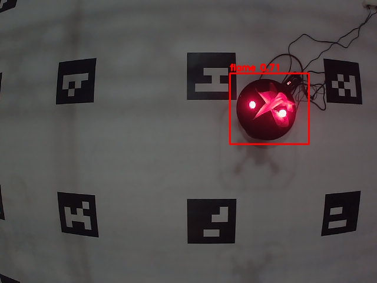

# 3. Design materials and components

## 3.1 Components, equipment and technical solutions

| No. | Component / assembly | Function in the system | Key specifications | Selection rationale / comments |
|---|---|---|---|---|
| 1 | SKYRIS TECHNIC 6S airframe | Carrier platform | Carbon frame, 4 arms, clip-on prop guards, TPU landing legs | Competition platform; guarded props for indoor flight |
| 2 | PX4 flight controller | Stabilisation, EKF2 state estimation, motor control | PX4 v1.17.0, EKF2 (vision + flow + range), offboard via MAVROS on TELEM2 at 921600 baud | Open-source, offboard API, GPS-denied fusion |
| 3 | 4-in-1 ESC + 4 motors | Propulsion | PWM 400 Hz, 1100 µs idle | Platform standard |
| 4 | 6S battery | Power | 6 cells, 21.9–24.8 V observed in our flights; low-voltage landing at 3.5 V/cell | Platform standard |
| 5 | Orange Pi 5 Pro + SKYRIS Shield | Onboard computer: ROS, perception, mission | RK3588S, 6 TOPS NPU, Ubuntu 20.04, ROS Noetic | NPU makes ≥ 10 FPS with three neural networks possible |
| 6 | Main camera (down) | ArUco navigation, optical flow, flame and tree detection | 640 × 480 @ 30 Hz, calibrated (fx ≈ 484 px) | Shared with the navigation stack, already calibrated |
| 7 | TR256i thermal camera (down) | Temperature map, thermal detection | 256 × 192, ~25 Hz, raw 16-bit (Kelvin × 64), −15…600 °C | Radiometric: real °C per pixel, not just a picture |
| 8 | VL53L1X rangefinder | Height above the floor for EKF2 | 0–4 m, ~9.4 Hz, I²C | Height reference in GPS-denied flight |
| 9 | ArUco marker field | Absolute position | 7.5 × 4.5 m, 45 markers (IDs 100–144), 0.25 m markers, 0.75 m pitch, origin at the field centre | Provided by the organisers; our fence is tied to it |
| 10 | WS281x LED ring | Visual alarm | 58 LEDs | Red flash when a source is confirmed |
| 11 | RC transmitter (ExpressLRS / CRSF) | Manual override, kill switch | Channel 8 = kill switch (`RC_MAP_KILL_SW=8`) | Mandatory by the competition rules |
| 12 | Ground station laptop (macOS) | Operator interface | BRICS Dashboard, Wi-Fi | Native app, works offline |
| 13 | Software (ours) | Mission, perception, safety, dashboard | Python 3.8 on the drone, Swift on the ground station | See [05_Architecture.md](05_Architecture.md) |

## 3.2 Photos of the completed prototype

Flight snapshots taken by the drone itself at the moment a source was confirmed are in [`Others/evidence/flights/`](../../Others/evidence/flights/). Example from the 21:20 survey (RGB camera, flame lamp confirmed):

