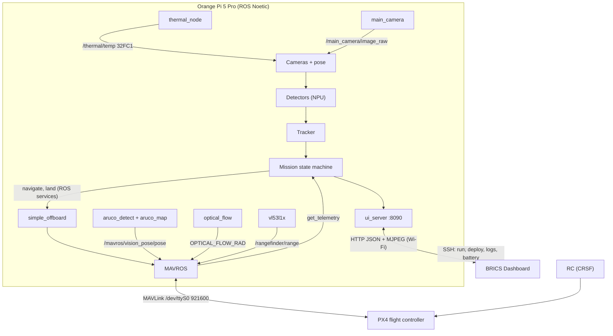
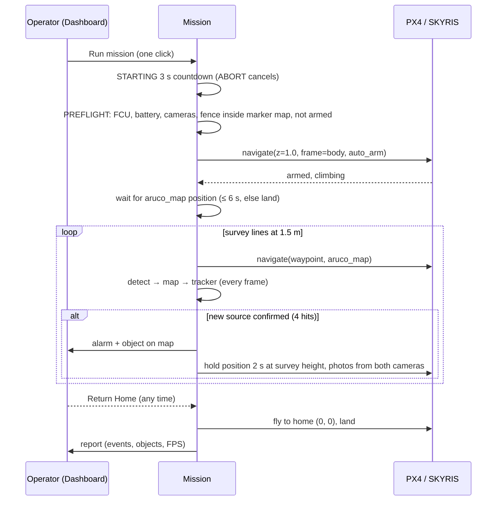

# 5. Extended architecture description

## 5.1 Main components, inputs and outputs

| Component | Code | Inputs | Outputs | Purpose |
|---|---|---|---|---|
| Thermal node | `tools/thermal_node.py`, `common/thermal.py` | USB frame 256 × 384 YUYV from the TR256i | `/thermal/temp` (32FC1, °C per pixel), `/thermal/image_raw` (false colour with °C scale), `/thermal/max`, `/thermal/fire` | Real temperatures from the raw half of the frame (Kelvin × 64) |
| Cameras | `drone/camera.py` | `main_camera/image_raw` + `camera_info`; `thermal/temp` | Frame + drone pose at capture time; pixel → map conversion | One interface for real, simulated and USB cameras |
| Detectors | `common/detector.py` | RGB image, thermal image, °C map | Boxes: class, confidence, pixel, °C | Thermal YOLO (`fire`, `flame`), RGB YOLO (`flame`), green-area detector (`tree`), ≥ 100 °C rule; NPU when available |
| Geometry / tracker | `common/geometry.py`, `common/selfcal.py` | Boxes + pose + camera model | Confirmed objects with map X/Y | Ray-to-floor projection, one entry per physical source, in-flight check of camera mounting and lens scale |
| Mission engine | `drone/mission_base.py`, `drone/case1_fire.py` | Config, operator commands, objects, telemetry | `navigate` / `land` calls, LED, snapshots, logs | State machine: survey, hold and photograph, return, land, report |
| Drone API + safety | `drone/technic_api.py` | SKYRIS services, MAVROS | Telemetry, safety decisions | Fence, battery, marker loss, arming failure, land fallback |
| Mission link | `common/ui_server.py` | Mission state | HTTP JSON status, MJPEG video, commands | Connection to the operator app |
| BRICS Dashboard | `dashboard/` (Swift) | HTTP 8090, video 8080, SSH | Operator view and commands | Ground station |
| PX4 + SKYRIS stack | third-party | ArUco pose, optical flow, rangefinder, setpoints | Motor commands | Flight control and GPS-denied estimation |

## 5.2 Interconnections

## 5.3 Operating sequence

## 5.4 Handling of anticipated failures

| Failure | Detection | Reaction | Demonstrated |
|---|---|---|---|
| Marker map not visible after take-off | No `aruco_map` pose within 6 s | Land in place | Real flight, 10 Nov (wrong map file loaded) |
| PX4 refuses to arm | `navigate` answer or still disarmed after 15 s | Mission stops, nothing flies | Real run 21:20:13, "Arming timed out" |
| Position lost in flight (markers out of view) | NaN pose in the 10 Hz safety check | Land | Unit tests |
| Leaving the fence / above 3 m | Pose outside `safety.fence` or z > 3 m | Land; waypoints outside the fence are never sent | Unit tests |
| Config area larger than the marker field | Fence > 0.3 m beyond the map loaded on the drone | Mission refuses to start (cannot be overridden) | Added after a real near-miss with a wrong config |
| Land service refused (FC left OFFBOARD) | Service answer | Retry, then switch PX4 to AUTO.LAND, unless the pilot has taken over | Unit tests |
| Low battery | V/cell < 3.5 (6 cells) | Land | Unit tests |
| Mission launched twice | Lock file | Second instance exits | Real drone, 10 Nov |
| Thermal camera garbage after power-up | Median temperature out of range | Frames skipped, camera reopened after 250 bad frames | Real drone |
| Link to the dashboard lost | — | Mission continues autonomously; RC remains in control | By design |

## 5.5 Strengths and limitations of the architecture

**Strengths**

1. **Real-time edge processing meets the frame-rate requirement in flight.** With all networks on the NPU, the full mission processed 13–14 FPS per stream and ≥ 10 FPS in 98–100 % of airborne seconds (flights 18:57, 21:11, 21:20: [`Others/evidence/flights/*/fps_summary.json`](../../Others/evidence/flights/)).
2. **Two physically different sensors plus temperature.** The thermal network finds hot sources by shape, the °C map confirms them, and the RGB network sees the flame. Each source is mapped once (flight 18:57: one heater mapped 3×; after the tracker change: one entry per source).
3. **Configuration-driven and simulation-backed.** The same code runs against a simulated drone and cameras ([`tests/sim_case1_venue.py`](../tests/sim_case1_venue.py): 8 scenarios with wrong lenses, flipped cameras and position noise, each finding exactly one fire and one flame within 0.05 m).

**Limitations**

1. **Navigation depends on the marker field.** Outside the 45-marker map there is no position, so the operating area is limited to the map (enforced in code). A field deployment needs GNSS/RTK or visual-inertial odometry.
2. **The thermal camera is not geometrically calibrated.** Its field of view (56°) is assumed and its offset from the drone centre is ignored. The in-flight self-calibration corrects the mounting rotation and lens scale only when the evidence is clear. Coordinate accuracy against tape-measured ground truth is still to be measured in Module B.
3. **Adding the thermal network costs frame rate.** Three networks at once leave a small margin over 10 FPS; the RGB flame model runs on every second frame to keep it.
