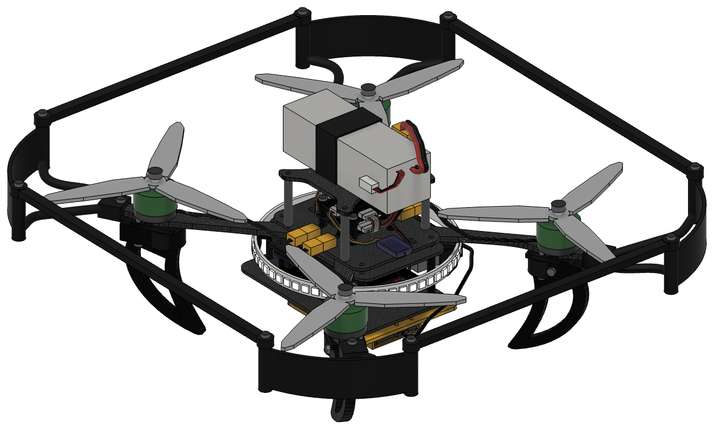
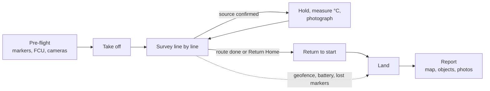
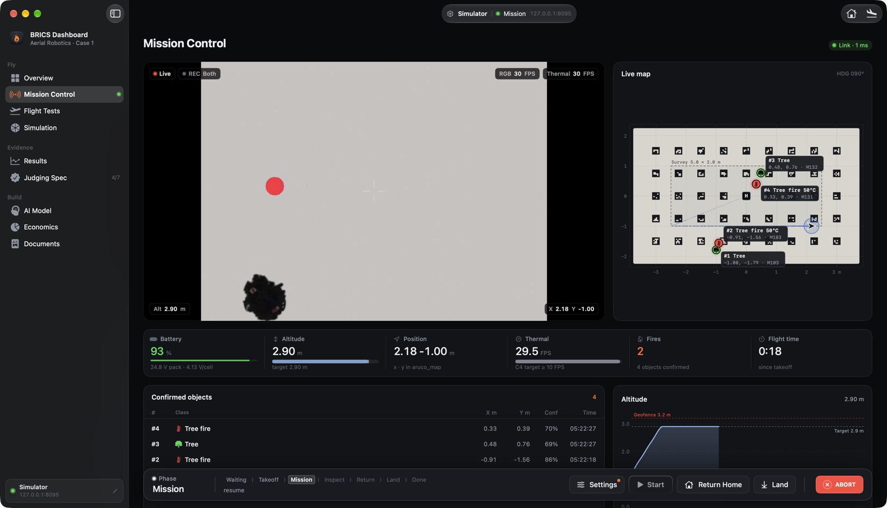
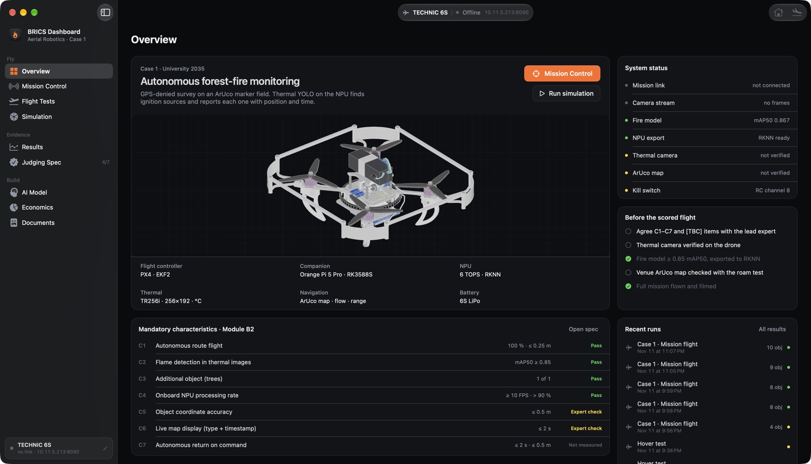
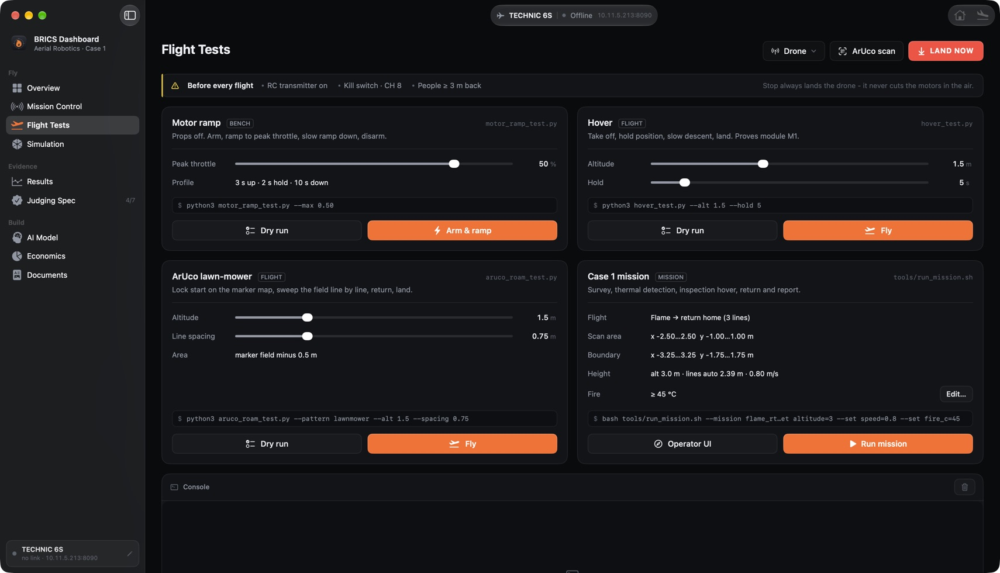
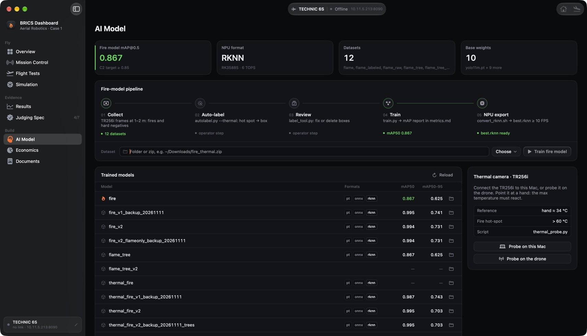

<div align="center">



# Autonomous Forest Fire Monitoring

<b>A quadcopter that searches a forest plot without GPS, finds ignition sources with a thermal camera and an onboard NPU, and puts each one on a live map.</b>

[](LICENSE)
[](Module_A/docs/03_Design_Materials_and_Components.md)
[](Module_A/docs/06_Tool_Selection.md)
[](Module_A/models/)
[](Module_A/dashboard/)

BRICS Hi-Tech Future Skills 2026 · Flying Robotics · Case 1 (University 2035)

[technical report](Module_A_Technicalreport.pdf) / [docs](Module_A/README.md) / [evidence](#evidence) / [flight logs](Others/evidence/) / [limitations](#known-limitations)

</div>

## Quick start

Run the whole Case 1 mission on a laptop against a simulated drone and field:

```bash
git clone https://github.com/kkjjkamal123/BRICS-HiTech-2026-Flying-Robotics.git
cd BRICS-HiTech-2026-Flying-Robotics/Module_A
python3.11 -m venv .venv && source .venv/bin/activate
pip install -r setup/requirements_laptop.txt
python drone/case1_fire.py --mock --autostart
```

Open http://127.0.0.1:8090 to watch it fly. The report lands in `runs/`.

On the real drone, deploy the code and start the same mission from the ground station:

```bash
DRONE=<drone-ip> bash setup/deploy_to_drone.sh
bash setup/build_dashboard.sh        # builds "BRICS Dashboard.app"
```

Step by step setup, the pre-flight checklist and the on-drone commands are in [Module_A/README.md](Module_A/README.md).

## What it is

The drone flies a lawn-mower survey over an ArUco marker field. Its position comes from the markers, optical flow and a rangefinder, so it needs no GPS. Two YOLO networks run on the Orange Pi's NPU: one on the TR256i thermal camera, one on the RGB camera. A detection counts only after it is seen in at least four frames.

For each confirmed source the drone holds position, measures the temperature, photographs it with both cameras and adds it to the map with its type, coordinates and time. It never flies close to a fire. Trees in the field are mapped as a second object class. At the end it returns to the start point, lands and writes a report.

## What makes it different

| | What we do |
|---|---|
| No GPS | Navigation from the ArUco map, optical flow and rangefinder. The mission refuses to start if its area reaches outside the marker field. |
| Thermal first | The thermal network finds heat, the RGB network confirms flame. Each source gets a temperature in °C, not just a box. |
| Runs on the NPU | Both networks are exported to RKNN for the RK3588S. Thermal inference takes 13.4 ms per frame, against 83 ms on the CPU. |
| One entry per source | A tracker merges repeated sightings, so a fire seen on three passes is reported once. |
| Safe by default | Geofence, altitude ceiling, low battery, lost markers and a mission time limit all end in a landing. The stop button always lands and never cuts the motors in the air. |
| Native ground station | A macOS app for live video, map and telemetry, flight tests, results, AI model and economics. |

## Evidence

Measured on the drone at the venue. Raw logs for every row are in [`Others/evidence/`](Others/evidence/).

| Claim | Evidence | Boundary |
|---|---|---|
| **Full autonomous mission** | Survey, detection, return and landing completed on 10 Nov. Landed at (0.012, 0.016) m against a start of (0.02, 0.01) m. | Venue marker map, indoor. |
| **Thermal network mAP@0.5 0.987** | YOLO11n at 256 px, 904 frames from our flights. Validated on two whole flights not used for training. | Heat source and flame lamp at the venue. |
| **RGB flame network mAP@0.5 0.995** | YOLO11n at 416 px, 257 frames. | Venue flame lamp only. |
| **≥ 10 FPS onboard (C4)** | 12.9–13.9 FPS mean, ≥ 10 FPS in 98–100 % of airborne seconds. | Measured with the RGB networks. The thermal network in flight is a Module B test. |
| **NPU matches CPU** | Same detections on 117 / 117 thermal frames and 12 / 12 RGB images. | |

The full table, with the failed first attempt and what we changed after it, is in [12_Test_Evidence.md](Module_A/docs/12_Test_Evidence.md).

## How a mission runs



## Ground station

| | |
|---|---|
|  |  |
| **Mission Control.** Live thermal and RGB video, map with confirmed objects, telemetry and the abort controls. | **Overview.** Hardware, system status and the C1–C7 checks. |
|  |  |
| **Flight Tests.** Motor ramp, hover, ArUco roam and the full mission, each with a dry run first. | **AI Model.** Training pipeline, trained models and their metrics. |

## Repository guide

| Folder | Contents |
|---|---|
| [`Module_A/drone/`](Module_A/drone/) | Case 1 mission, mission engine, drone API with the safety layer, cameras |
| [`Module_A/common/`](Module_A/common/) | Detectors, tracker and geometry, thermal decoding, operator UI server |
| [`Module_A/config/`](Module_A/config/) | Mission configuration and the venue ArUco map |
| [`Module_A/models/`](Module_A/models/) | Trained networks (ONNX and RKNN) with their metrics |
| [`Module_A/train/`](Module_A/train/) | Labelling, training and export |
| [`Module_A/dashboard/`](Module_A/dashboard/) | BRICS Dashboard, the macOS ground station |
| [`Module_A/tests/`](Module_A/tests/) | Flight-safety tests, network tests, venue simulator |
| [`Module_A/docs/`](Module_A/docs/) | Module A documentation, 01 to 12 |
| [`Others/`](Others/) | Flight logs, datasets, drone configuration, economic model, Docker |

## Known limitations

- Coordinate accuracy against tape-measured positions (C5) is not measured yet.
- Tree detection has not been tested on the real trees at the venue (C3).
- Return Home reaction time (C7) is not measured yet.
- The ground station is macOS only.

All four of the open measurements are planned for Module B.

## Team

Kamalesh Vadivelu Syamala and Bejin Paul Josephin Paul Benjamin, Chennai Institute of Technology.

## License

[GNU AGPL-3.0](LICENSE). Third-party components are listed in [THIRD_PARTY_NOTICES.md](Module_A/THIRD_PARTY_NOTICES.md).
